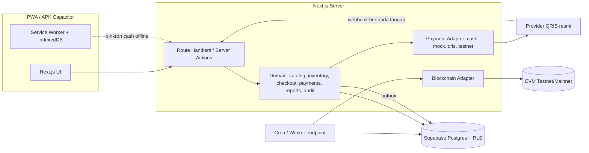
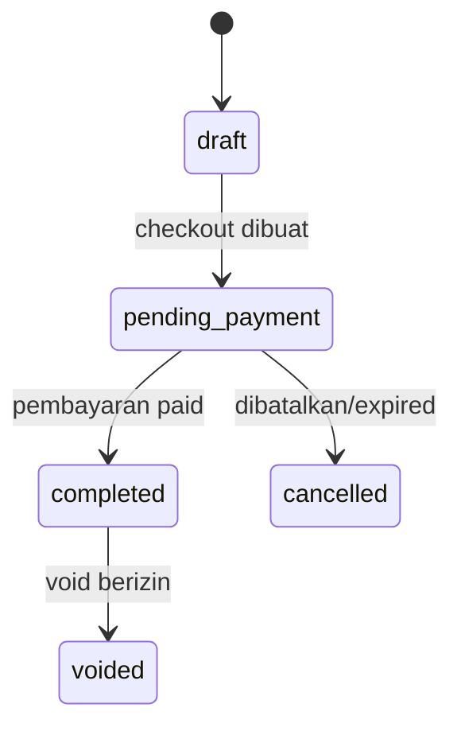
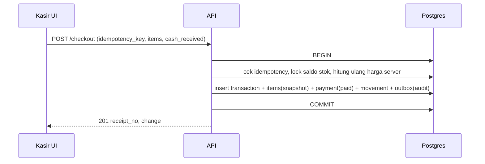
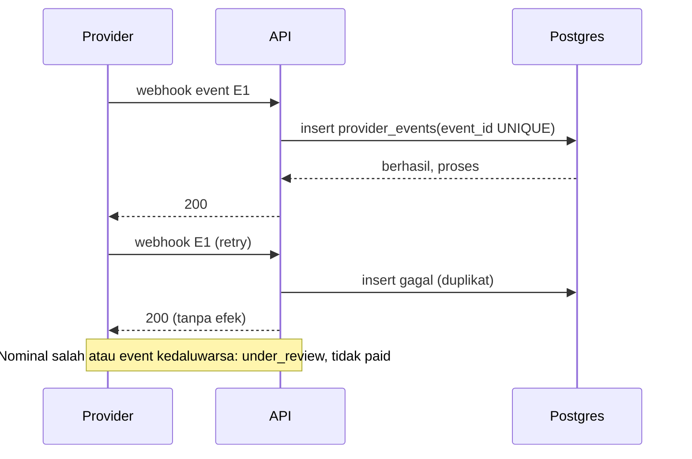
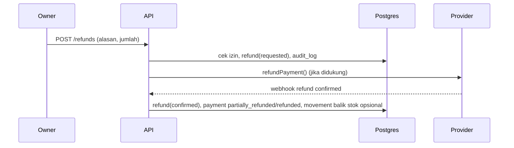
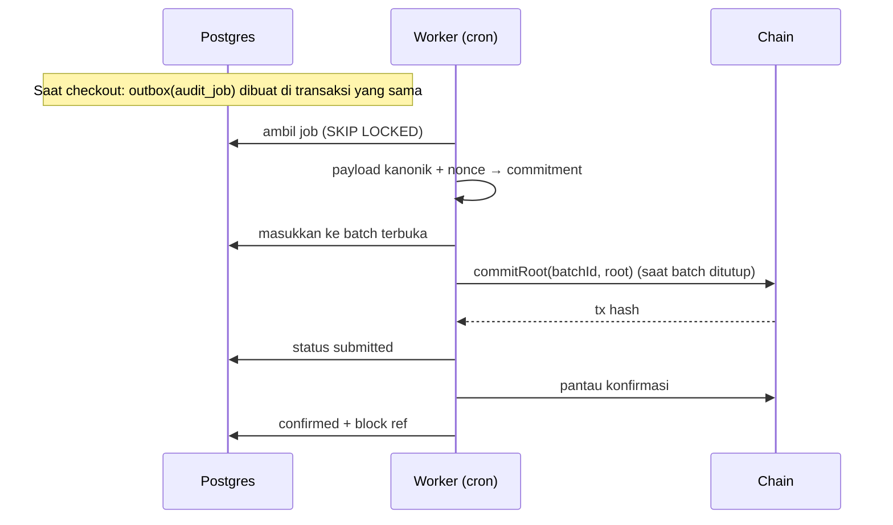

# Arsitektur

Modular monolith Next.js + Supabase Postgres. Layanan eksternal diakses lewat adapter. Efek samping lewat outbox.

## Diagram sistem


## Modul domain
| Modul | Tanggung jawab |
|---|---|
| catalog | produk, kategori, harga, riwayat harga, CSV |
| inventory | saldo, movement, validasi stok |
| checkout | keranjang server, pembuatan transaksi, state machine |
| payments | adapter, payment_attempts, webhook, rekonsiliasi |
| reports | agregasi harian/mingguan/bulanan, kas |
| audit | payload kanonik, commitment, outbox, batch, verifikasi |
| iam | profil, membership, peran, PIN, audit log |

Aturan dependensi: UI → API → domain → DB. Domain tidak tahu Next.js. Adapter tidak tahu UI.

## State machine terpisah

**sale_status:** draft, pending_payment, completed, cancelled, voided.
**payment_status:** pending, awaiting_customer, processing, paid, expired, failed, cancelled, under_review, partially_refunded, refunded.
Transisi valid payment:
- pending → awaiting_customer | cancelled | failed
- awaiting_customer → processing | paid | expired | cancelled | failed | under_review
- processing → paid | failed | under_review
- paid → partially_refunded | refunded | under_review
- partially_refunded → refunded
- expired, failed, cancelled, refunded: terminal (kecuali under_review ditinjau manual)

**inventory_status:** not_committed → committed → reversed. **audit_status:** not_submitted → queued → submitted → confirmed | failed | verification_mismatch.

Transisi ditegakkan di server dengan fungsi `assertTransition(from, to)` dan constraint/trigger DB. Perbedaan: sale dibuat ≠ pembayaran dimulai ≠ pembayaran terkonfirmasi ≠ stok dikomit ≠ refund diminta ≠ refund dikonfirmasi ≠ audit terkonfirmasi.

## Checkout tunai


## Checkout QRIS
```mermaid
sequenceDiagram
  participant K as Kasir UI
  participant A as API
  participant D as Postgres
  participant P as Provider
  K->>A: POST /checkout (method=qris)
  A->>D: transaction(pending_payment) + payment_attempt(pending)
  A->>P: createPaymentRequest(ref, amount IDR)
  P-->>A: qr + expires_at
  A->>D: attempt=awaiting_customer
  A-->>K: QR + nominal
  P->>A: webhook (signature)
  A->>D: simpan event unik, verifikasi nominal/ref/mata uang
  A->>D: BEGIN; attempt=paid; sale=completed; commit stok; outbox; COMMIT
  K->>A: polling status
  A-->>K: paid, struk
```

## Pembayaran gagal / webhook retry


## Refund

Tunai: refund dicatat manual dengan izin Owner dan masuk rekonsiliasi kas.

## Audit blockchain


## Pekerjaan latar belakang
Postgres outbox + endpoint cron (Vercel Cron atau pg_cron memicu HTTP). Tabel `blockchain_job_outbox` dengan `FOR UPDATE SKIP LOCKED`, backoff eksponensial, dead-letter setelah N kali. Batas serverless: durasi fungsi pendek, jadi tiap job kecil dan idempoten. Bila volume atau latensi menuntut, pindah ke worker Node terpisah (ADR 001 revisit).

## Multi-tenant
`shop_id` di semua tabel bisnis, RLS berbasis `shop_memberships`, plus otorisasi di server.

## Struktur repo
Lihat bagian "Struktur" di `TECH_STACK.md`.
