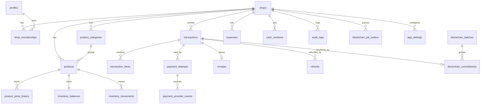

# Skema Database

PostgreSQL (Supabase). Uang: `bigint` rupiah. Waktu: `timestamptz` UTC. ID: `uuid` (`gen_random_uuid()`). Semua tabel bisnis punya `shop_id`.

## ER Diagram (inti)


## Tabel
| Tabel | Isi utama | Catatan |
|---|---|---|
| shops | nama, timezone, currency | |
| profiles | id (= auth.users), nama | tanpa data sensitif |
| shop_memberships | shop_id, user_id, role, pin_hash | role: owner, cashier, inventory, auditor |
| product_categories | shop_id, nama | |
| products | sku, barcode, nama, unit, price_idr, cost_idr, min_stock, status | unique(shop_id, sku), soft archive |
| product_price_history | product_id, old/new price, changed_by | append-only |
| inventory_balances | product_id, quantity | check qty >= 0 kecuali setting |
| inventory_movements | product_id, type, qty_delta, before, after, reason, ref_transaction_id, actor | append-only |
| customers | shop_id, label | opsional, tanpa PII wajib |
| transactions | receipt_no, sale_status, subtotal, discount, total, idempotency_key, cashier_id, customer_label | unique(shop_id, idempotency_key) |
| transaction_items | snapshot nama, unit, harga, qty, line_total | tidak berubah |
| payment_attempts | method, status, provider_ref, amount, expires_at | unique(provider, provider_ref) |
| payment_provider_events | provider, event_id, payload (redacted), signature_valid | unique(provider, event_id) |
| receipts | transaction_id, rendered snapshot | |
| refunds | transaction_id, amount, status, reason, requested_by | |
| expenses | kategori, jumlah, tanggal, dicatat oleh | |
| cash_sessions | opening, closing, expected, selisih | |
| audit_logs | actor, action, entity, diff | append-only |
| blockchain_commitments | transaction_id, commitment, nonce_enc, status, batch_id, tx_hash, chain_id | unique(transaction_id) |
| blockchain_batches | merkle_root, count, status, tx_hash, block | |
| blockchain_job_outbox | type, payload, attempts, next_run_at, status | SKIP LOCKED |
| app_settings | shop_id, key, value | allow_negative_stock, qris_enabled, dll |

## Implementasi Sprint 1

Migrasi `supabase/migrations/20261018000100_sprint_1_iam.sql` mengimplementasikan fondasi IAM berikut:

- `profiles`, dibuat otomatis ketika pengguna Supabase Auth dibuat.
- `shops`, dengan `timezone` selalu `Asia/Jakarta` dan mata uang `IDR`.
- `shop_memberships`, dengan peran `owner`, `cashier`, `inventory`, dan `auditor`.
- RLS pada ketiganya. Pengguna hanya membaca profil sendiri, membership sendiri, dan toko tempat ia menjadi anggota.
- RPC `create_shop_for_owner(shop_name)` yang hanya dapat dipanggil pengguna terautentikasi. Fungsi membuat toko dan membership `owner` dalam satu transaksi.

Tes pgTAP `supabase/tests/database/rls.test.sql` memverifikasi pembuatan toko, isolasi dua tenant, serta penolakan penambahan membership langsung oleh klien. Jalankan dengan `pnpm db:test` setelah Supabase lokal aktif.

## Contoh DDL (draf Sprint berikutnya)
```sql
create type sale_status as enum ('draft','pending_payment','completed','cancelled','voided');
create type payment_status as enum ('pending','awaiting_customer','processing','paid','expired','failed','cancelled','under_review','partially_refunded','refunded');

create table products (
  id uuid primary key default gen_random_uuid(),
  shop_id uuid not null references shops(id),
  sku text not null, barcode text,
  name text not null, unit text not null,
  price_idr bigint not null check (price_idr >= 0),
  cost_idr bigint not null default 0 check (cost_idr >= 0),
  min_stock integer not null default 0,
  status text not null default 'active' check (status in ('active','archived')),
  created_at timestamptz not null default now(),
  updated_at timestamptz not null default now(),
  unique (shop_id, sku)
);

create table transactions (
  id uuid primary key default gen_random_uuid(),
  shop_id uuid not null references shops(id),
  receipt_no text not null,
  sale_status sale_status not null default 'draft',
  subtotal_idr bigint not null check (subtotal_idr >= 0),
  discount_idr bigint not null default 0 check (discount_idr >= 0),
  total_idr bigint not null check (total_idr >= 0),
  idempotency_key text not null,
  cashier_id uuid not null references profiles(id),
  customer_label text,
  created_at timestamptz not null default now(),
  unique (shop_id, receipt_no),
  unique (shop_id, idempotency_key),
  check (total_idr = subtotal_idr - discount_idr)
);

create table payment_provider_events (
  id uuid primary key default gen_random_uuid(),
  provider text not null, event_id text not null,
  payload jsonb not null, received_at timestamptz not null default now(),
  unique (provider, event_id)
);

-- RLS contoh
alter table products enable row level security;
create policy products_member_read on products for select
  using (exists (select 1 from shop_memberships m
    where m.shop_id = products.shop_id and m.user_id = auth.uid()));
```
Append-only (price_history, movements, audit_logs): cabut UPDATE/DELETE dari role aplikasi, atau trigger yang menolak.

## Indeks penting
`products(shop_id, lower(name))` (trgm untuk pencarian), `products(shop_id, barcode)`, `transactions(shop_id, created_at desc)`, `inventory_movements(product_id, created_at)`, `blockchain_job_outbox(status, next_run_at)`.

## Konkurensi stok
Checkout: `select ... from inventory_balances where product_id = any(...) order by product_id for update`, validasi, lalu update. Urutan lock tetap untuk mencegah deadlock.

## Nomor struk
Counter per shop per hari di tabel `receipt_counters(shop_id, day, last_no)` dengan `insert ... on conflict do update ... returning`.

## Zona waktu
Hari bisnis dihitung `created_at at time zone 'Asia/Jakarta'`.
