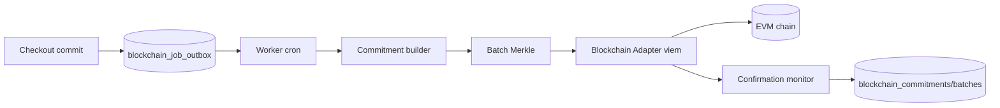

# Arsitektur Blockchain

DB Postgres adalah sumber kebenaran. Blockchain hanya lapisan bukti: transaksi tertentu ada dan isi yang diaudit tidak berubah tanpa terdeteksi.

## Komponen


## Adapter
```ts
interface ChainAdapter {
  chainId: number;
  submitCommitment(c: Hex): Promise<TxRef>;
  submitRoot(batchId: bigint, root: Hex, count: number): Promise<TxRef>;
  getReceipt(tx: Hex): Promise<Receipt | null>;
  readCommitment(c: Hex): Promise<OnChainRecord | null>;
  readRoot(batchId: bigint): Promise<OnChainRecord | null>;
}
```
Implementasi `evm-viem` dan `noop` (default saat `BLOCKCHAIN_ENABLED=false`).

## Status audit
not_submitted → queued → submitted → confirmed. Cabang: failed (retry/dead-letter), verification_mismatch (hasil verifikasi tidak cocok).
Kegagalan chain **tidak** mengubah status penjualan atau pembayaran.

## Keandalan
- Outbox dibuat dalam transaksi checkout yang sama (atomik).
- Job diambil `FOR UPDATE SKIP LOCKED`, idempoten (cek commitment/tx sudah ada sebelum kirim).
- Retry backoff eksponensial dengan jitter, dead-letter setelah N percobaan, tampil di Diagnostik, tombol retry untuk Owner.
- Nonce transaksi (nonce akun) dikelola satu pengirim pada satu waktu (lock) agar tidak bentrok.
- Rekonsiliasi: job memeriksa tx submitted yang belum terkonfirmasi, dan memverifikasi sampel commitment confirmed terhadap chain.

## Pemilihan jaringan
Lihat `COST_ANALYSIS.md`. Tidak ada jaringan yang di-hardcode, hanya konfigurasi `BLOCKCHAIN_CHAIN_ID` dan RPC.

## Kunci
Signer khusus audit, tanpa dana selain gas, di secret manager. Rotasi: Owner kontrak memberi role ke signer baru lalu mencabut yang lama.
