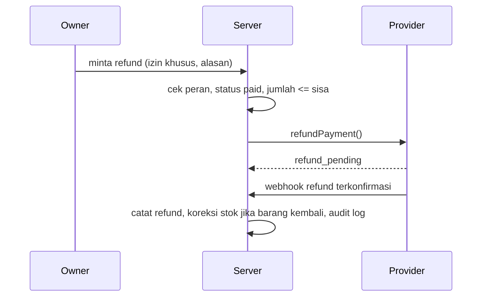

# Arsitektur Pembayaran

## Prinsip
1. Status bayar hanya dari konfirmasi server provider yang terverifikasi.
2. Satu attempt = satu transaksi internal = satu referensi unik.
3. Pemrosesan idempoten.
4. Metode nonaktif tidak bisa diaktifkan lewat state browser atau request buatan.
5. Mock, sandbox, dan nyata dibedakan di server dan UI.

## Interface
```ts
interface PaymentAdapter {
  id: string;
  capabilities: { dynamicQr: boolean; refund: boolean; expiry: boolean; webhook: boolean };
  createPaymentRequest(i: { reference: string; amountIdr: number; expiresAt: Date }): Promise<PaymentRequest>;
  getPaymentStatus(reference: string): Promise<ProviderStatus>;
  verifyWebhook(headers: Headers, rawBody: string): Promise<VerifiedEvent | null>;
  expirePaymentRequest(reference: string): Promise<void>;
  reconcilePayment(reference: string): Promise<ProviderStatus>;
  refundPayment?(i: RefundInput): Promise<RefundResult>;
}
```
Implementasi: `cash`, `mock`, `qris-<provider>`, `testnet-crypto`. Cash tidak memakai webhook, langsung `paid` saat uang diterima dan dicatat.

## Pemetaan status
Setiap adapter punya tabel pemetaan status provider → `payment_status` internal, diuji. Status provider tak dikenal menjadi `under_review`.

## Feature flag
`FEATURE_QRIS_LIVE`, `FEATURE_CRYPTO_TESTNET`, `FEATURE_CRYPTO_LIVE` (env) AND setting `payment_methods_enabled` per shop. Keduanya harus benar. Pemeriksaan di `checkout` sisi server.

## Fee
`payment_fee_idr` dicatat per attempt jika provider melaporkan, dipakai di laporan (bruto, diskon, refund, bersih, fee, estimasi laba).

## Mode
| Mode | Sumber | Uang nyata | Lencana UI |
|---|---|---|---|
| mock | Adapter lokal | tidak | MOCK |
| sandbox | Sandbox provider | tidak | SANDBOX |
| live | Provider produksi | ya | tanpa lencana |
Live hanya aktif jika onboarding selesai dan env produksi diatur.

## Detail
`QRIS_INTEGRATION.md`, `WEBHOOK_SECURITY.md`, `PAYMENT_RECONCILIATION.md`, `DIGITAL_ASSET_POLICY.md`.

## Diagram sequence

### Checkout tunai
```mermaid
sequenceDiagram
  participant K as Kasir (UI)
  participant S as Server
  participant D as Postgres
  K->>S: POST /checkout (Idempotency-Key, items, cash_received)
  S->>D: BEGIN; cek key; validasi harga/stok server-side
  S->>D: insert transaction+items, kurangi stok, insert outbox audit
  S->>D: COMMIT
  S-->>K: 201 receipt_no, kembalian
```

### Checkout QRIS dan webhook (termasuk retry)
```mermaid
sequenceDiagram
  participant K as Kasir
  participant S as Server
  participant P as Provider QRIS
  participant D as Postgres
  K->>S: checkout metode QRIS
  S->>D: transaksi pending + payment_attempt (ref unik)
  S->>P: createPaymentRequest(ref, amount)
  P-->>S: payload QR + expiry
  S-->>K: tampilkan QR (status: menunggu)
  P->>S: webhook (signature)
  S->>S: verifikasi signature, ref, amount, currency
  S->>D: insert provider_event (unique event_id)
  alt event baru dan valid
    S->>D: BEGIN; paid; stok; outbox audit; COMMIT
  else duplikat
    S-->>P: 200 tanpa efek
  else tidak cocok
    S->>D: status under_review
  end
  K->>S: polling status
  S-->>K: paid atau tetap menunggu
```

### Pembayaran gagal atau kedaluwarsa
```mermaid
sequenceDiagram
  participant S as Server
  participant P as Provider
  participant D as Postgres
  S->>P: getPaymentStatus (cron rekonsiliasi)
  P-->>S: expired/failed
  S->>D: payment_attempt expired; transaksi tetap belum lunas
  Note over S,D: Stok tidak pernah dipotong. Kasir bisa buat attempt baru.
```

### Refund (hanya jika provider mendukung)

